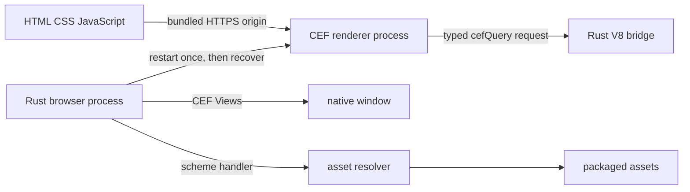

# Ceri architecture

Ceri keeps the browser engine inside the application boundary. Rust owns the native process model and CEF lifecycle. Web code owns presentation and application state. TypeScript is an authoring layer, not a second runtime that ships beside the app.

## Process model

The executable follows CEF's multi-process model:

- the browser process creates the CEF Views window, registers the app origin, controls navigation, and owns the asset resolver
- renderer processes execute the web application and receive the narrow runtime bridge
- GPU and utility processes are started by CEF from the same bundled executable
- the Windows sandbox is enabled by default through the CEF helper bootstrap

The browser process verifies the entry route before calling `cef::initialize`. The profile lives in a per-user Ceri directory so Chromium's cache and session state do not collide with another application.

## App origin and asset routing

The app loads from `https://app.ceri.invalid`. This is an application-owned origin registered with CEF's HTTPS scheme handler factory. It is not resolved by DNS and it does not require a listening socket.

The resolver receives the URL path, normalizes it once, and checks the canonical result against the packaged asset root. It then returns a file or a Ceri-owned response document. Query strings are not used as filesystem paths. The resolver does not follow symlinks outside the asset root.

The origin gives normal browser code a stable secure context for modules, storage, fetch, workers, and other web APIs. It also makes an accidental loopback-server dependency impossible in the normal bundle path.

## Runtime bridge

The SDK keeps the familiar `window.cefQuery` call shape so existing CEF-oriented web code can be adapted without adding a Node dependency. Ceri installs the function from the Rust render-process handler. The handler:

1. accepts one object with a string request
2. rejects persistent queries
3. rejects requests larger than 1024 bytes
4. checks that the current frame is the main frame on `https://app.ceri.invalid`
5. accepts the exact `runtimeInfo` request
6. invokes the supplied success or failure callback with a validated response

The bridge has no general-purpose evaluator, no filesystem method, and no network proxy. `cefQueryCancel` is a no-op because the current runtime response is completed during the native call and does not create a pending request.

## Navigation and recovery

Top-level navigation is allowed only for the app origin and Ceri's own data-URI recovery documents. Popups are blocked. A renderer termination cancels the normal load state and reloads once. A second termination loads a recovery document and stops the loop. Load errors are converted to the same application-owned recovery surface.

The recovery page is generated by Rust, carries a restrictive CSP, and points back to the verified entry URL. This prevents a missing asset or a dead renderer from becoming a browser-owned error page that tells the user to repair an unrelated local server.

## Security boundaries

- the browser process owns the filesystem path and canonicalization checks
- the renderer sees only the web asset origin and the explicit bridge function
- the bridge performs origin and frame checks inside the native handler
- application documents receive a restrictive CSP, `nosniff`, `no-referrer`, and frame denial headers
- remote top-level navigation and popup creation are denied
- sandboxed Windows builds use the CEF sandbox bootstrap and ship the helper DLL in the generated bundle

The bridge boundary is intentionally small. New native capabilities should be added as typed, audited methods with explicit input limits and tests for untrusted frames.

## Platform contract

The source layout covers Windows, macOS, and Linux CEF targets on x64 and ARM64. CEF binaries are target-specific, so a release pipeline must build once per target and package that target's CEF archive. The Windows x64 path is the locally validated path for this repository. macOS and Linux still require their native toolchains, CEF archive, signing, and installed-runtime smoke gates before a release claim is made.
