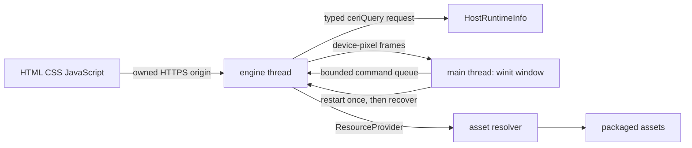

# Ceri architecture

Ceri keeps the browser engine inside the application boundary. Rust owns the native process model and the engine lifecycle. Web code owns presentation and application state. TypeScript is an authoring layer, not a second runtime that ships beside the app.

The engine is `ceri-engine`, a Rust-native engine in this repository that runs in-process on one dedicated engine thread. It loads the packaged app from `https://app.ceri.invalid` through the asset-origin policy in `src/assets.rs` and exposes one typed runtime query to page code.

## Process model

The runtime is a single process:

- the main thread owns the native window, input translation, the display scale factor and the desktop theme
- one engine thread owns the browser state, navigation, layout, paint and the page script runtime, reached through a bounded command queue
- frames cross back as device-pixel surfaces that the window presents through a CPU surface
- worker threads carry page-visible `Worker` objects, with provider requests serviced through an explicit host pump

The runtime verifies the entry route before the engine starts. The profile lives in a per-user Ceri directory, so storage and window geometry do not collide with another application.

There is no process sandbox yet, because there is no separate renderer process to confine. What confines the page today is the surface the engine exposes: script has no filesystem, process, socket or clipboard handle, and every resource read crosses the embedder-owned `ResourceProvider` seam, which applies the asset path policy. A renderer process per window under a Windows job object and restricted token is the next isolation milestone, not a shipped property.

## App origin and asset routing

The app loads from `https://app.ceri.invalid`. This is an application-owned origin served through the engine's `ResourceProvider` seam. It is not resolved by DNS and it does not require a listening socket.

The resolver receives the URL path, normalizes it once, and checks the canonical result against the packaged asset root. It then returns a file or a Ceri-owned response document. Query strings are not used as filesystem paths. The resolver does not follow symlinks outside the asset root.

The origin gives normal browser code a stable secure context for modules, storage, fetch, workers, and other web APIs. It also makes an accidental loopback-server dependency impossible in the normal bundle path.

## Runtime bridge

`window.ceriQuery` takes one request string and returns a promise. It exists only when the host supplies `HostRuntimeInfo`, and it answers exactly one request, `{"method":"runtimeInfo","version":1}`, with the engine name, the recovery state and the session ID. Any other request rejects. The SDK validates the response shape before handing it to page code.

The bridge has no general-purpose evaluator, no filesystem method, and no network proxy. New native capabilities should arrive as typed commands with explicit input limits, an allowlist per window and origin, and tests for untrusted callers.

## Navigation and recovery

Top-level navigation stays on the app origin and Ceri's own recovery documents. A page can fetch outside its origin only through HTTPS origins the operator lists with `--ceri-allow-origin`. If the engine thread stops, the window restarts it once; a second failure shows the engine's own recovery document and stops the loop. Load errors are converted to the same application-owned recovery surface, so a missing asset never becomes a generic browser error page.

## Security boundaries

- the runtime owns the filesystem path and canonicalization checks
- the engine sees only the app asset origin, the allowlisted HTTPS origins and the explicit bridge function
- remote top-level navigation is denied
- the clipboard and file input reach the page through host seams that pass text and bytes, never handles or paths

## Platform contract

The source layout covers Windows, macOS, and Linux on x64 and ARM64. The engine has no per-target archive, and its bundle is the executable plus packaged assets.

The Windows x64 path is the locally validated path for this repository. Clipboard, file input and time zone adapters are implemented for Windows; other platforms return typed errors for clipboard and file input until their adapters land. macOS and Linux still require signing and installed-runtime smoke gates before a release claim is made.
